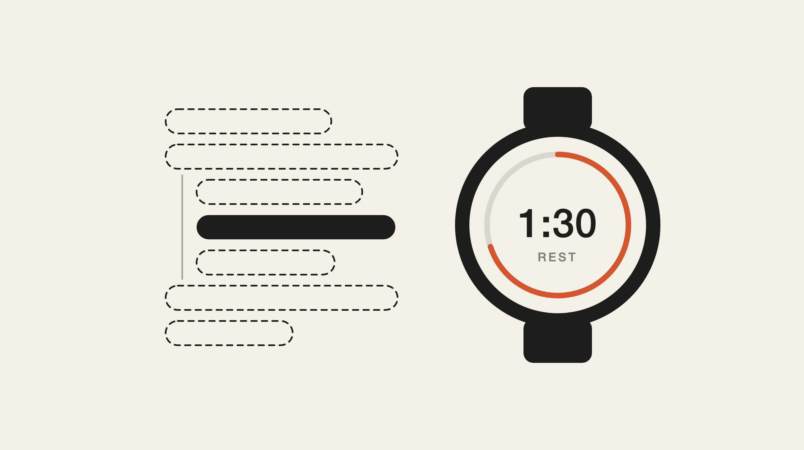

# garmin-claude-starter



**Esto es el armazón, no mi sistema. El 95% del valor está en el contexto que acumules tú.**

Un punto de partida para que Claude Code cree tus entrenamientos, los suba a tu reloj Garmin y aprenda de lo que falla. Lo que hay aquí me costó meses de prueba y error: la estructura de los workouts que Garmin acepta, las trampas que no avisan y un mecanismo para que el sistema no descubra lo mismo tres veces. Con esto deberías tenerlo funcionando en una tarde.

Artículo que explica el porqué: [URL_ARTICULO]

## Qué es y qué no es

**Es:**

- Una skill para construir workouts de fuerza (y otros deportes) en el formato exacto que acepta Garmin Connect y subirlos al reloj.
- Un catálogo de trampas ([GOTCHAS.md](GOTCHAS.md)) con el síntoma que ves en el reloj y la regla que lo evita. Es la parte más valiosa del repo.
- Una skill de onboarding que comprueba que todo funciona y te lleva hasta la primera sesión.
- Una skill para persistir aprendizajes, para que cada fallo se convierta en una regla escrita en vez de en un recuerdo.
- Plantillas vacías para tu perfil, tu plan y tu log.
- Un workout de ejemplo que sube bien a la primera.

**No es:**

- Mi plan de entrenamiento, mis cargas ni mi historial. No están aquí a propósito.
- Un entrenador. No sabe nada de ti hasta que se lo cuentes, y lo que se lo cuentes en el uso diario vale mucho más que lo que escribas el primer día.
- Una integración oficial con Garmin (ver la advertencia de abajo).

El armazón es lo fácil de copiar. Lo que hace que esto funcione es el contexto: qué te molesta, qué ejercicio no puedes hacer en tu gimnasio, qué carga moviste la semana pasada, qué decidiste cambiar y por qué. Eso no se puede compartir, tienes que acumularlo tú.

## Requisitos

- **[Claude Code](https://docs.claude.com/en/docs/claude-code).** Este armazón está pensado para Claude Code, porque el sistema necesita leer y escribir ficheros en tu ordenador: tu perfil, tu plan, tu log y las reglas que va aprendiendo. Claude Desktop puede crear workouts con el mismo MCP, pero no puede guardar lo que aprende, y sin eso se pierde la parte que hace que mejore.
- Una cuenta de Garmin Connect y un reloj que admita workouts estructurados.
- [`uv`](https://docs.astral.sh/uv/), para lanzar el servidor MCP. Él mismo se descarga la versión de Python que necesita.

## ⚠️ Advertencia: esto no es una API oficial

La conexión con Garmin usa [garmin_mcp](https://github.com/Taxuspt/garmin_mcp), un servidor MCP **de la comunidad**. Por debajo usa [python-garminconnect](https://github.com/cyberjunky/python-garminconnect), que habla con la misma interfaz que usa la app de Garmin Connect. **No es una API oficial de Garmin y puede romperse** cuando Garmin cambie algo, sin aviso. Si un día deja de funcionar, mira primero los issues de esos dos repos.

Tus credenciales de Garmin solo se usan una vez, en tu terminal, para generar tokens. No las metas en ningún fichero ni se las des a Claude en la conversación.

## Instalación en cinco pasos

### 1. Clona el repo e instala `uv`

```bash
git clone https://github.com/apbello/garmin-claude-starter.git
```

```bash
cd garmin-claude-starter
```

Si no tienes `uv` (comprueba con `uv --version`):

```bash
curl -LsSf https://astral.sh/uv/install.sh | sh
```

### 2. Autentícate con Garmin

Antes de configurar el MCP, para que encuentre los tokens al arrancar:

```bash
uvx --python 3.12 --from git+https://github.com/Taxuspt/garmin_mcp garmin-mcp-auth
```

Te pide email, contraseña y el código MFA si lo tienes activado. Los tokens se guardan en `~/.garminconnect` y **caducan a los ~6 meses**. Cuando un día Claude no pueda leer tu Garmin, casi seguro es esto:

```bash
uvx --python 3.12 --from git+https://github.com/Taxuspt/garmin_mcp garmin-mcp-auth --force-reauth
```

### 3. Añade el MCP de Garmin a Claude Code

```bash
claude mcp add --scope user garmin -- uvx --python 3.12 --from git+https://github.com/Taxuspt/garmin_mcp garmin-mcp
```

`--scope user` lo deja disponible en todas tus carpetas. Comprueba que aparece con `claude mcp list`.

### 4. Instala las skills y prepara tu carpeta de trabajo

Las skills van a tu carpeta personal de Claude Code:

```bash
mkdir -p ~/.claude/skills && cp -r skills/* ~/.claude/skills/
```

Tus datos van en una carpeta aparte, **no dentro de este repo** (es público y no quieres que tu perfil acabe en un fork). Por ejemplo, `~/entreno`:

```bash
mkdir -p ~/entreno && cp plantillas/*.md GOTCHAS.md ejemplos/fuerza-full-body.json ~/entreno/
```

### 5. Arranca con `primeros-pasos`

```bash
cd ~/entreno && claude
```

Y dile:

> Empecemos.

La skill `primeros-pasos` hace el resto contigo: comprueba que Claude ve tu Garmin, sube el workout de ejemplo y lo verifica, te dice qué mirar en el reloj, prepara tu perfil con lo mínimo para arrancar y te propone la primera sesión. Si algo falla por el camino, te dice qué es y cómo arreglarlo.

## Por dónde empezar de verdad

El orden que funciona, después de haberlo hecho al revés:

1. **Instala y prueba.** Los cinco pasos de arriba, terminando con `primeros-pasos`. Una tarde.
2. **Vete al gimnasio y apunta lo que falle.** Un ejercicio sin nombre, un descanso que no cuenta, una máquina que no tienes, una carga que no cuadra. Todo a `log.md`, en bruto, desde el móvil si hace falta.
3. **Usa el mecanismo de aprendizaje.** Vuelve a `~/entreno` con lo que apuntaste y deja que `persistir-aprendizaje` lo procese: cada fallo se convierte en una regla escrita en el sitio correcto. Esta es la pieza que hace que el sistema mejore en vez de descubrir lo mismo tres veces.
4. **Veinte minutos el domingo.** Repasa el log de la semana con Claude, ajusta el plan de la siguiente y sube los workouts.
5. **Cuatro semanas antes de juzgar.** La primera semana va a estar llena de fricciones. Eso es el sistema aprendiendo, no el sistema fallando.

**No merece la pena escribir tu contexto por adelantado.** Es tentador sentarse a redactar un perfil completo antes de empezar. No lo hagas: lo que escribas en frío será genérico y la mitad no servirá. El contexto útil sale de usarlo, de lo que falla en el gimnasio y de las decisiones que tomas al revisarlo. Las plantillas están casi vacías a propósito.

## Estructura

```
.
├── README.md
├── GOTCHAS.md                     # catálogo de trampas de Garmin: síntoma + regla
├── LICENSE
├── skills/
│   ├── primeros-pasos/            # onboarding: verifica la conexión y arranca contigo
│   │   └── SKILL.md
│   ├── garmin-workout-creator/    # construir y subir workouts
│   │   ├── SKILL.md
│   │   └── references/exercises.md
│   └── persistir-aprendizaje/     # convertir cada fallo en una regla escrita
│       └── SKILL.md
├── plantillas/                    # perfil, plan y log, vacíos
└── ejemplos/                      # un workout de fuerza que sube bien
```

## Contribuir

Si descubres una trampa nueva, abre un issue o un PR a `GOTCHAS.md` con el síntoma, la regla, la fecha y el modelo de reloj. Es el formato que hace que el catálogo sea fiable.

## Créditos

La base original de la skill `garmin-workout-creator` es de Rodrigo Alvarez. Las trampas, correcciones y el resto del repo son de Alvaro Perez Bello.

## Licencia

MIT. Ver [LICENSE](LICENSE).
